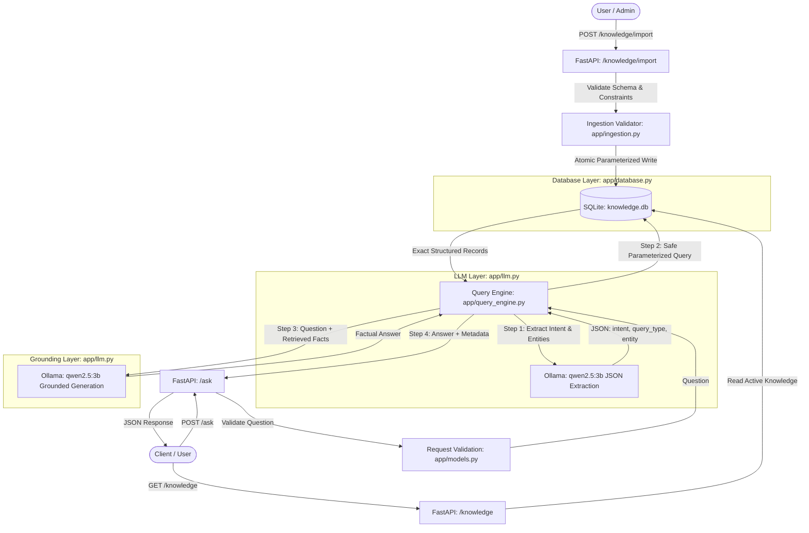

# RAGless Knowledge Assistant

An open-source, completely local AI knowledge assistant that implements **dynamic JSON knowledge ingestion + deterministic structured retrieval with local LLM orchestration** instead of traditional vector-based Retrieval-Augmented Generation (RAG).

Built with **FastAPI**, **SQLite**, and **Ollama (`qwen2.5:3b`)**. 100% free, private, offline-capable, and cost-free—no paid APIs, no vector databases, no document chunking, and no embeddings.

---

## Table of Contents

- [Overview](#overview)
- [What "RAGless" Means in This Project](#what-ragless-means-in-this-project)
- [Why This Is Not RAG (Comparison)](#why-this-is-not-rag-comparison)
- [System Architecture (Dynamic Ingestion & Retrieval)](#system-architecture-dynamic-ingestion--retrieval)
- [Knowledge Schema & Ingestion Format](#knowledge-schema--ingestion-format)
- [Technology Stack](#technology-stack)
- [Prerequisites & Installation](#prerequisites--installation)
- [Ollama Setup & Model Verification](#ollama-setup--model-verification)
- [Running the Backend](#running-the-backend)
- [API Endpoints & Documentation](#api-endpoints--documentation)
  - [`GET /`](#get-)
  - [`GET /health`](#get-health)
  - [`GET /knowledge`](#get-knowledge)
  - [`POST /knowledge/import`](#post-knowledgeimport)
  - [`POST /ask`](#post-ask)
- [Testing](#testing)
- [Security Considerations](#security-considerations)
- [Project Limitations](#project-limitations)
- [Future Improvements](#future-improvements)

---

## Overview

Modern generative AI systems frequently suffer from hallucinations, data leakage, and nondeterministic outputs when answering domain-specific organizational questions. Traditional RAG attempts to solve this by splitting documents into chunks, generating vector embeddings, and running semantic similarity search in a vector database.

While vector RAG works for unstructured documents (e.g., long PDFs or articles), it introduces significant disadvantages for **structured, factual corporate data**:
1. **Nondeterministic retrieval**: Nearest-neighbor vector queries can retrieve irrelevant or outdated chunks.
2. **Computational overhead**: Chunking pipelines, vector indexing, embedding models, and vector stores add latency and cost.
3. **No strict schema safety**: Hallucinated facts can slip into prompts unnoticed.

The **RAGless Knowledge Assistant** replaces semantic vector search with **dynamic JSON knowledge ingestion + LLM-assisted intent classification + deterministic SQL retrieval + grounded answer generation**:

```text
User / Admin
      │
      ▼ (JSON Knowledge File)
Knowledge Ingestion (Validation & Safe Parameterized SQL)
      │
      ▼
SQLite Database (Dynamic Single Source of Truth)
      │
      ▼ (User Question)
Local LLM (qwen2.5:3b) ──► Intent Classification & Entity Extraction (JSON)
      │
      ▼
Deterministic Parameterized Query ──► SQLite Database
      │
      ▼
Retrieved Structured Records (JSON)
      │
      ▼
Local LLM (qwen2.5:3b) ──► Grounded Natural Language Answer
      │
      ▼
Final Verified Response
```

The SQLite database is the **single source of truth**. The LLM is **never** relied upon as a factual knowledge store.

---

## What "RAGless" Means in This Project

In this architecture, **"RAGless"** means:
- **No Vector Databases**: Chroma, FAISS, Pinecone, Qdrant, or Weaviate are not used.
- **No Embedding Models**: No sentence transformers, OpenAI embeddings, or vectorization.
- **No Text Chunking**: No character splitting, overlapping windows, or fuzzy similarity metrics.
- **No Arbitrary SQL Execution**: The LLM does **not** write raw SQL queries, which prevents SQL injection and hallucinated tables/columns.
- **Controlled Structured Retrieval**: Natural language questions are translated into constrained, typed parameters and executed against predefined, parameterized SQLite queries.

---

## Why This Is Not RAG (Comparison)

| Feature / Dimension | Traditional Vector RAG | RAGless Knowledge Assistant (This Project) |
|---|---|---|
| **Data Representation** | Dense vector embeddings (float arrays) | Relational tables in SQLite (rows and columns) |
| **Retrieval Mechanism** | Vector similarity (Cosine distance, kNN) | Parameterized relational queries (`SELECT WHERE ...`) |
| **Accuracy / Determinism** | Approximate / Probabilistic | Exact / Deterministic (100% precision) |
| **Knowledge Ingestion** | Chunking, tokenizing, embedding pipelines | Strict JSON validation, atomic relational transactions |
| **Dependencies** | Vector DB, embedding models, chunkers | Lightweight SQLite database, standard Python |
| **API Costs & Privacy** | Frequently uses paid cloud APIs | 100% Local, offline, private, zero cost |
| **SQL Injection Risk** | N/A (unstructured) or High if LLM writes SQL | **Zero** (no arbitrary LLM-generated SQL permitted) |
| **LLM Role** | Consumes chunks, potentially extrapolates | Intent parsing + factual grounding strictly from DB |
| **Data Updates** | Re-embedding and re-indexing required | Instant atomic SQL replace/update |

---

## System Architecture (Dynamic Ingestion & Retrieval)



---

## Knowledge Schema & Ingestion Format

Dynamic knowledge can be uploaded via `POST /knowledge/import` as a JSON file matching this structure:

```json
{
  "company": {
    "name": "TechNova",
    "location": "Hyderabad",
    "employees": 500
  },
  "departments": [
    {
      "name": "AI",
      "employees": 80
    },
    {
      "name": "Backend",
      "employees": 120
    },
    {
      "name": "Data Science",
      "employees": 70
    }
  ],
  "leave_policy": [
    {
      "leave_type": "Annual Leave",
      "days": 24
    },
    {
      "leave_type": "Sick Leave",
      "days": 12
    },
    {
      "leave_type": "Casual Leave",
      "days": 10
    }
  ]
}
```

### Validation Guarantees:
- **`company`**: `name` and `location` cannot be empty; `employees` must be an integer > 0.
- **`departments`**: Each department must have a non-empty `name` and `employees` >= 0. Duplicate department names (case-insensitive) are strictly rejected.
- **`leave_policy`**: Each leave rule must have a non-empty `leave_type` and `days` >= 0. Duplicate leave types are rejected.
- **Atomicity**: Ingestion uses an atomic transaction—existing data is only replaced if the entire payload passes validation.

A ready-to-use sample file is located at [`data/sample_knowledge.json`](file:///c:/Users/M.Karthik%20Reddy/Documents/projects/ragless-assistant/data/sample_knowledge.json).

---

## Technology Stack

- **Backend Framework**: [FastAPI](https://fastapi.tiangolo.com/) (OpenAPI docs, async support, multipart file upload)
- **ASGI Server**: [Uvicorn](https://www.uvicorn.org/)
- **Data Validation & Settings**: [Pydantic v2](https://docs.pydantic.dev/)
- **Multipart Form Parser**: [python-multipart](https://andrew-d.github.io/python-multipart/)
- **Relational Database**: [SQLite3](https://docs.python.org/3/library/sqlite3.html) (built into Python standard library, zero setup)
- **Local Inference Engine**: [Ollama](https://ollama.com/) (HTTP REST API on port 11434)
- **Local Language Model**: `qwen2.5:3b` (fast, lightweight 3B parameter model optimized for instruction following and structured JSON extraction)

---

## Prerequisites & Installation

### 1. Prerequisites
- Python 3.10+ (tested on Python 3.14)
- [Ollama](https://ollama.com/download) installed and running locally

### 2. Virtual Environment Setup
Ensure the virtual environment is activated:

```bash
# Windows (PowerShell)
.venv\Scripts\Activate.ps1

# Windows (Command Prompt)
.venv\Scripts\activate.bat

# Linux / macOS
source .venv/bin/activate
```

### 3. Install Dependencies
```bash
pip install -r requirements.txt
```

---

## Ollama Setup & Model Verification

1. Ensure the Ollama daemon/application is running:
```bash
ollama --version
```

2. Download and verify the `qwen2.5:3b` model:
```bash
ollama pull qwen2.5:3b
```

3. Confirm that `qwen2.5:3b` appears in your installed models list:
```bash
ollama list
```

---

## Configuration & Switching LLM Providers

The assistant supports multiple LLM inference providers via environment variables, defaulting to local Ollama if unspecified:

### 1. Local Ollama (`qwen2.5:3b`) - Default & Offline
```bash
export LLM_PROVIDER=ollama
export OLLAMA_BASE_URL=http://localhost:11434
export OLLAMA_MODEL=qwen2.5:3b
```

### 2. Nebius Token Factory (NVIDIA Nemotron) - Cloud
```bash
export LLM_PROVIDER=nebius
export NEBIUS_API_KEY="your-nebius-api-key"
export NEBIUS_BASE_URL="https://api.tokenfactory.nebius.com/v1/"
export NEBIUS_MODEL="nvidia/nemotron-3-super-120b-a12b"
export LLM_TIMEOUT_SECONDS=30
export LLM_MAX_RETRIES=3
export LLM_TEMPERATURE=0.0
```

Refer to [`.env.example`](file:///c:/Users/M.Karthik%20Reddy/Documents/projects/ragless-assistant/.env.example) and [`docs/PHASE2_NEBIUS.md`](file:///c:/Users/M.Karthik%20Reddy/Documents/projects/ragless-assistant/docs/PHASE2_NEBIUS.md) for full architecture details.

---

## Running the Backend

Start the FastAPI application with Uvicorn:

```bash
uvicorn app.main:app --host 127.0.0.1 --port 8000 --reload
```

Once running, interactive documentation is available at:
- **Swagger UI**: [http://127.0.0.1:8000/docs](http://127.0.0.1:8000/docs)
- **ReDoc**: [http://127.0.0.1:8000/redoc](http://127.0.0.1:8000/redoc)

---

## API Endpoints & Documentation

### `GET /`
Returns service status, version, and links to all available endpoints.

```bash
curl -X GET http://127.0.0.1:8000/
```

---

### `GET /health`
Checks SQLite database connectivity and local Ollama server status.

```bash
curl -X GET http://127.0.0.1:8000/health
```

---

### `GET /knowledge`
Returns the currently active corporate knowledge from SQLite in structured JSON format.

**Request**:
```bash
curl -X GET http://127.0.0.1:8000/knowledge
```

**Response**:
```json
{
  "company": {
    "name": "TechNova",
    "location": "Hyderabad",
    "employees": 500
  },
  "departments": [
    {"name": "AI", "employees": 80},
    {"name": "Backend", "employees": 120},
    {"name": "Data Science", "employees": 70}
  ],
  "leave_policy": [
    {"leave_type": "Annual Leave", "days": 24},
    {"leave_type": "Sick Leave", "days": 12},
    {"leave_type": "Casual Leave", "days": 10}
  ]
}
```

---

### `POST /knowledge/import`
Uploads and validates a JSON knowledge file, clears prior data, and atomically writes the new records into SQLite.

**Request**:
```bash
curl -X POST http://127.0.0.1:8000/knowledge/import \
  -F "file=@data/sample_knowledge.json"
```

**Response**:
```json
{
  "status": "success",
  "message": "Knowledge imported successfully",
  "company": "TechNova",
  "departments_imported": 3,
  "leave_policies_imported": 3
}
```

---

### `POST /ask`
Natural-language question answering endpoint. Translates questions into structured SQLite lookups and generates grounded answers based on the currently imported corporate knowledge.

#### Example 1: Ingested Company Details
**Request**:
```bash
curl -X POST http://127.0.0.1:8000/ask \
  -H "Content-Type: application/json" \
  -d '{"question": "Where is the company located and how many employees work there?"}'
```

#### Example 2: Ingested Leave Policy
**Request**:
```bash
curl -X POST http://127.0.0.1:8000/ask \
  -H "Content-Type: application/json" \
  -d '{"question": "How many days of annual leave do employees get?"}'
```

**Response**:
```json
{
  "question": "How many days of annual leave do employees get?",
  "answer": "24 annual leave days are provided.",
  "source": "sqlite",
  "intent": "leave_policy",
  "query_type": "leave_days",
  "retrieved_data": [
    {
      "leave_type": "Annual Leave",
      "days": 24
    }
  ],
  "processing_time_ms": 1294.73
}
```

#### Example 3: Ingested Department Headcount
**Request**:
```bash
curl -X POST http://127.0.0.1:8000/ask \
  -H "Content-Type: application/json" \
  -d '{"question": "How many employees are in Backend?"}'
```

**Response**:
```json
{
  "question": "How many employees are in Backend?",
  "answer": "120",
  "source": "sqlite",
  "intent": "department_employees",
  "query_type": "dept_headcount",
  "retrieved_data": [
    {
      "name": "Backend",
      "employees": 120
    }
  ],
  "processing_time_ms": 1236.57
}
```

---

## Testing

A comprehensive test suite of 28 automated tests is provided in [`tests/test_backend.py`](file:///c:/Users/M.Karthik%20Reddy/Documents/projects/ragless-assistant/tests/test_backend.py):

```bash
python -m unittest discover -s tests
```

**Test Coverage**:
- Database connectivity & schema health
- Safe parameterized queries for company, departments, and leave policy
- Request validation (empty, whitespace, length bounds)
- Knowledge file validation (empty files, malformed JSON, missing fields, negative counts, duplicate department names, duplicate leave types)
- Atomic ingestion transaction verification
- Deterministic query mapping
- Ollama service downtime simulation (HTTP 503)
- Real end-to-end question answering on dynamic `TechNova` corporate data

---

## Security Considerations

1. **No Dynamic SQL Execution**:
   The LLM is **never** permitted to generate arbitrary SQL queries. All database access routes through fixed, strictly parameterized queries (`?` placeholders).
2. **Pydantic Validation**:
   Inputs and imported files are sanitized, validated against strict business rules, and length-bounded.
3. **No Shell Commands**:
   The application does not execute subprocesses or shell commands based on user input.
4. **No Internal Leakage**:
   Custom exception handlers catch uncaught exceptions, connection timeouts, and validation errors, returning structured JSON errors without exposing Python stack traces or database paths.

---

## Project Limitations

- **Schema Specificity**: The query engine currently maps intents for company information, department headcounts, and leave policies. Adding new business domains requires defining new parameterized database handlers.
- **Single-Turn Context**: Currently handles independent, single-turn questions without conversation history memory.
- **Relational Scope**: Designed for factual and quantitative tabular data; not intended for long-form narrative documents or unstructured prose.

---

## Future Improvements

1. **Multi-Turn Context**: Add session-scoped memory so users can ask follow-up questions.
2. **Dynamic Schema Registry**: Allow new tables and parameterized query templates to be registered via configuration files without altering query engine code.
3. **Hybrid Router**: Intelligently route tabular/numerical questions to deterministic SQL retrieval, and document queries to a local full-text search (SQLite FTS5) without requiring heavy vector embeddings.
4. **Audit Trail**: Provide an administrative audit log of query categories, ingested versions, and response latency.
